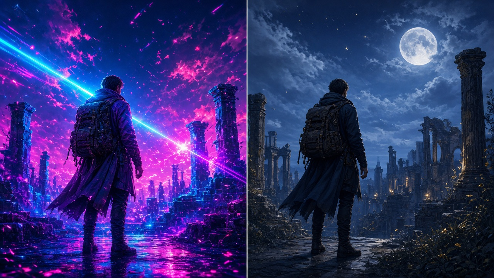

# Prism

**用对话做品牌内容生产。**  
查规范 → 出图出片 → 改一版 → 归档资产；同一套多租户控制台里完成，后续可接到社媒发布与付费投放。

[](https://github.com/jintao0693/Prism/actions/workflows/ci.yml)
[](LICENSE)

| | |
|---|---|
| **开发者** | [jintao](https://github.com/jintao0693) |
| **状态** | MVP 可用（创作对话 / 知识库 / 资产 / 火山方舟） |
| **产品说明** | [docs/PRODUCT.md](docs/PRODUCT.md) |
| **许可** | MIT |

---

## 解决什么问题

营销与内容团队缺的不是「再一个出图按钮」，而是**可审计的创意生产线**：规范要管事、改稿要不断血、同角色跨镜头不能崩、静帧还能接着出预告。Prism 把这条链路收成一次对话：

1. **规范进知识库** — 主色、禁忌、历史 KV 变成对话里的活约束  
2. **人话驱动多模态** — 出图、改稿、拉预告都在同一会话  
3. **血缘可追溯** — 每一轮记住上一张，`parentAssetId` 挂成资产树  
4. **结果进资产库** — 评审、复用、后续发布 / 投放有同一套归档

适合：游戏发行内容组、品牌 / 电商运营、投放创意、内容主理人。

---

## 现在能做什么

| 你想做的事 | Prism 怎么帮你 |
|------------|----------------|
| 问品牌主色、立绘禁忌、活动话术 | 勾选知识库，对话里直接答，可引用入库文档 |
| 从零出一张主视觉 / 封面 / KV | 自然语言生图，结果进资产中心 |
| 在上一张基础上改色、改氛围、保留构图 | 自动走图生图，并记下父子素材关系 |
| 把定稿静帧做成短预告 | 图生视频，带任务进度 |
| 多团队共用、密钥隔离 | 租户 / 工作空间隔离；火山 Key 租户自配 |

**下一阶段**：视频片段检索、社媒矩阵发布、巨量 / Meta 投放草稿 — 见 [ROADMAP.md](ROADMAP.md)。

---

## 产品案例：发行组真正难的两件事

随便出一个好看的二次元图不难。难的是：**改稿不断血、规范真的管事、同角色跨镜头不崩、静帧还能接着出预告**——而且这一切要能进资产库被评审追问「这张从哪来的」。

下面用虚构手游 **《幻境：星落传说》** 讲两件高级作业。基础出图 / 出片联调见后文与 [docs/GAME_CASES.md](docs/GAME_CASES.md)。

---

### 高级案例 1 · 母版血缘树：一轮对话长出可审计的资产树

**难在哪**  
普通生图工具给你的是一堆互不相关的 JPG。发行评审要问的是：初稿是谁？偏暖版挂在谁下面？预告片的首帧是哪一张定稿？有没有偷偷撞上禁用的霓虹紫？

**Prism 怎么做**

1. 勾选知识库：主色深空靛 / 星辉金、禁用高饱和霓虹紫  
2. 同一会话：文生图母版 →「再偏暖，构图人物不动」图生图 →「做成 5 秒推进预告」图生视频  
3. 每一步带 `parentAssetId` 血缘；规范不是事后 PDF，而是对话里的活约束


| 联调真出 · 母版 | 联调真出 · 偏暖子稿 | 规范纠偏示意（左违规 / 右合规） |
|---|---|---|
|  |  |  |

预告成片（首帧挂在定稿上）：[下载 5 秒 MP4](docs/media/cases/case3-teaser.mp4)

**别人看完会想用的点**  
不是「又能出一张图」，而是**创意迭代变成一棵树**：可回退、可对比、可追责、可接着做视频——这是工作流，不是玩具。

---

### 高级案例 2 · 定妆锁角色：同旅人三叙事镜，挑一镜拉预告

**难在哪**  
内容日历要同一周交「探索 / 战斗 / 城镇夜」三张叙事静帧 + 一条预告。外包三组最容易把主角脸和披风细节做成三个人。发行要的是：**先锁定妆，再铺镜头，再动起来**。

**Prism 怎么做**

1. 先出 / 上传定妆三视图，挂进会话当参考（角色锁）  
2. 连续下达三镜 brief，始终「同一银发旅人、靛色披风、星辉金扣」  
3. 选定探索镜做图生视频：缓慢推进 + 星尘，气质跟静帧连续


| 探索镜 | 战斗镜 | 城镇夜镜 |
|---|---|---|
|  |  |  |

**别人看完会想用的点**  
这是 **IP 生产线**，不是单次灵感：定妆 → 多镜叙事板 → 跨模态预告，全在同一工作空间归档，下周活动还能从同一母版继续长。

---

### 支撑能力（联调已通）

这些高级作业站在已跑通的基础能力上：

| 能力 | 你在产品里怎么用 | 素材 |
|------|------------------|------|
| 规范进知识库 | 勾选设定库追问主色 / 禁忌 |  |
| 文生图 → 图生图改稿 | 「再偏暖，保留构图」 | 见上表母版 / 子稿 |
| 图生视频 | 定稿静帧拉 5 秒氛围预告 | [MP4](docs/media/cases/case3-teaser.mp4) |
| 以图搜库 / 带回对话 | 历史 KV 召回后再创作 | 见 [GAME_CASES](docs/GAME_CASES.md) |

```text
知识库锁规范 + 定妆锁角色
        → 母版 KV（文生图）
        → 可追溯改稿（图生图 / parentAssetId）
        → 三镜叙事板（同 IP）
        → 选镜拉预告（图生视频）
        → 全部进入资产中心，可供评审与复用
```

---

## 5 分钟体验

演示账号：`linqing@prism.demo` / `prism123`（工作空间示例 `ws_spring`）

```bash
# 准备依赖
.\scripts\dev.ps1          # Windows
# ./scripts/dev.sh         # macOS / Linux

# 终端 1 · API
cd apps/api && .\.venv\Scripts\activate
uvicorn app.main:app --reload --host 127.0.0.1 --port 8000

# 终端 2 · 控制台
cd apps/web && npm run dev
```

打开 http://localhost:3000 → 登录 → 选工作空间 → **设置**里填写火山方舟 Key（可选；无 Key 也可走演示模式看流程）。

复现基础闭环（案例 1–3）：

```bash
# 需本机 API 已启动；配好火山 Key 可跑真图真视频
python scripts/run_game_cases.py
```

更细的安装、Docker、模型配置见 [apps/api/README.md](apps/api/README.md)、[apps/web/README.md](apps/web/README.md)。

---

## 文档

| 想了解 | 去看 |
|--------|------|
| 产品定位、用户、MVP / Phase 范围 | [docs/PRODUCT.md](docs/PRODUCT.md) |
| 当前做到哪了 | [docs/PROGRESS.md](docs/PROGRESS.md) |
| 产品与技术优化 backlog | [docs/OPTIMIZATION.md](docs/OPTIMIZATION.md) |
| 游戏向案例联调详情 | [docs/GAME_CASES.md](docs/GAME_CASES.md) |
| 路线图 | [ROADMAP.md](ROADMAP.md) |
| 架构与目录 | [docs/TECHNICAL.md](docs/TECHNICAL.md)、[docs/STRUCTURE.md](docs/STRUCTURE.md) |
| 如何贡献 | [CONTRIBUTING.md](CONTRIBUTING.md) |

---

## 开发者与贡献

本项目由 **jintao**（[@jintao0693](https://github.com/jintao0693)）设计与维护。欢迎 Issue / PR，请先阅读 [CONTRIBUTING.md](CONTRIBUTING.md)。

```bash
cd apps/api && pip install -e ".[dev]" && ruff check app && pytest -q
cd apps/web && npm run lint && npm run build
```

## License

[MIT](LICENSE) © jintao
