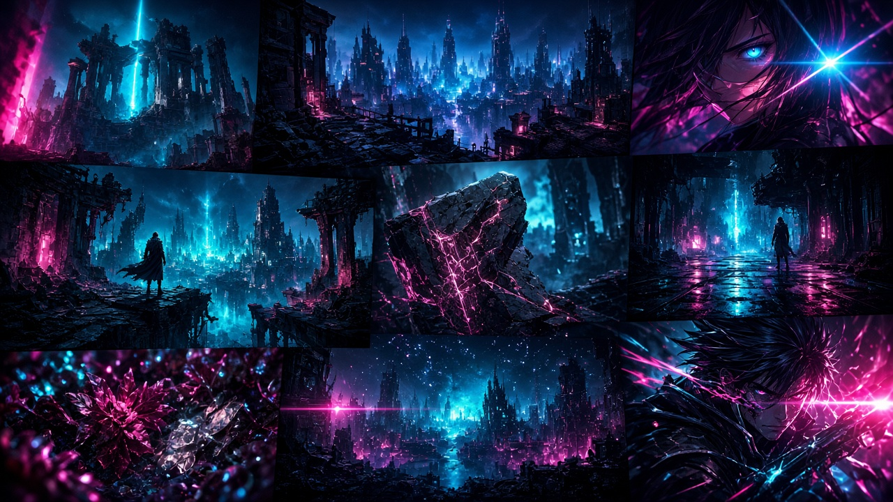
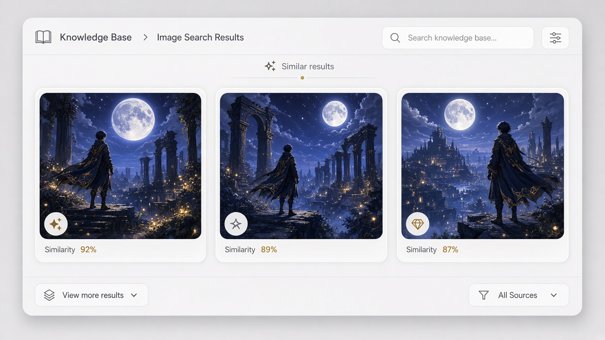
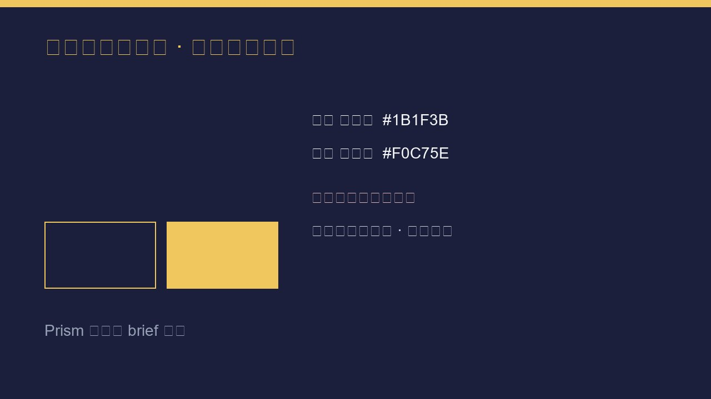
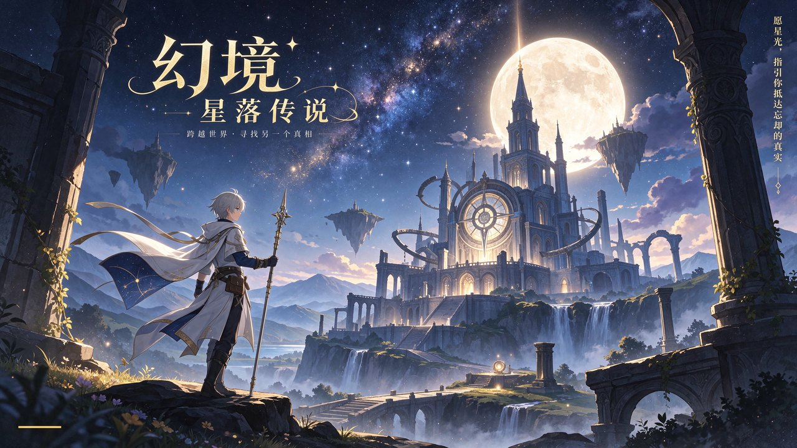

# Prism

**用对话做品牌内容生产。**  
查规范 → 出图出片 → 改一版 → 归档资产；同一套多租户控制台里完成，后续可接到社媒发布与付费投放。

[](https://github.com/jintao0693/Prism/actions/workflows/ci.yml)
[](LICENSE)

| | |
|---|---|
| **开发者** | [jintao](https://github.com/jintao0693) |
| **状态** | MVP 可用（创作对话 / 知识库 / 资产 / 火山方舟） |
| **产品说明** | [docs/PRODUCT.md](docs/PRODUCT.md) |
| **许可** | MIT |

---

## 解决什么问题

营销与内容团队日常要在「品牌规范、历史素材、生图工具、剪辑、网盘」之间来回跳。Prism 把这条链路收成一次对话：

1. **先对齐品牌** — 把设定、主色、禁忌词、历史 KV 放进知识库，提问时直接引用  
2. **再说人话出片** — 「做一张商店页头图」「再偏暖一点」「做成 5 秒预告」  
3. **改稿不断血** — 每一轮生成记住上一张图，图生图 / 图生视频可追溯  
4. **素材进资产库** — 结果自动归档，方便后续复用（发布与投放在路线图里）

适合：品牌 / 电商运营、游戏发行内容组、投放创意、内容主理人。

---

## 现在能做什么

| 你想做的事 | Prism 怎么帮你 |
|------------|----------------|
| 问品牌主色、立绘禁忌、活动话术 | 勾选知识库，对话里直接答，可引用入库文档 |
| 从零出一张主视觉 / 封面 / KV | 自然语言生图，结果进资产中心 |
| 在上一张基础上改色、改氛围、保留构图 | 自动走图生图，并记下父子素材关系 |
| 把定稿静帧做成短预告 | 图生视频，带任务进度 |
| 多团队共用、密钥隔离 | 租户 / 工作空间隔离；火山 Key 租户自配 |

**下一阶段**：视频片段检索、社媒矩阵发布、巨量 / Meta 投放草稿 — 见 [ROADMAP.md](ROADMAP.md)。

---

## 产品案例：同一款二次元开放世界的发行作战周

虚构手游 **《幻境：星落传说》** 上线前 7 天。内容组要同时搞定：规范对齐、商店页 KV、预告片、**三端投放尺寸**、以及把「竞品味参考」洗成自家品牌。  
下面不是接口冒烟，而是别人看完会想「我们也这样出素材」的完整作业。案例 1–3 为联调真出图 / 出片；案例 4–5 为同世界观高级玩法示意。完整记录 → [docs/GAME_CASES.md](docs/GAME_CASES.md)。

---

### 高级玩法 A · 一次 brief，横 / 方 / 竖三端齐出

**为什么高级**  
真实发行很少只交一张横版。商店要 16:9、社媒 Feed 要 1:1、Stories / 渠道开屏要 9:16——同一旅人、同一月下遗迹，**比例变了，IP 不能散**。

**在 Prism 里怎么做**

1. 先用知识库锁死主色深空靛 / 星辉金与立绘禁忌（见案例 1）  
2. 同一会话连续下达三轮尺寸 brief：「商店横版头图」「社媒方图特写」「竖版 Stories 攀星轨」  
3. 资产中心并排归档，评审时一眼看出「是不是同一个人、同一套光」

| 商店 16:9 | 社媒 1:1 | Stories 9:16 |
|---|---|---|
|  |  |  |

**你省下的**  
不用在三个工具里各开一轮工程文件；对话里改一句「再偏暖 / 留白再多一点」即可三端同步迭代气质。

---

### 高级玩法 B · 以图搜库 → 带回对话 → 洗成「下周活动版」

**为什么高级**  
运营手里常有一张「感觉对、但品牌不对」的参考（竞品 KV、灵感截图）。正确流程不是盲抄，而是：**在历史素材里找近亲 → 挂回会话 → 用品牌规范重做一版**。

**在 Prism 里怎么做**

1. 知识库已入库本周历史 KV；用参考图做**以图搜图**，召回气质相近的自家素材  
2. 命中结果点「带回对话」，草稿与参考一并进创作会话  
3. 说：「保留旅人与遗迹叙事，去掉霓虹青品撞色，按深空靛 + 星辉金重做商店页活动版」

| 灵感参考（偏竞品霓虹） | 库内相似召回 | 品牌洗稿后的活动版 |
|---|---|---|
|  |  |  |

**你省下的**  
不再「网盘翻历史图 + 另开修图软件 + 口头对齐规范」；检索、改稿、归档都在同一工作空间。

---

### 基础闭环 1 · 先把「能拍的规范」问清楚

发行周一：商店页、社媒、预告都要开工，规范散落在文档里。建知识库「幻境设定库」，入库主色 / 禁忌 / 主题词，对话勾选后追问 brief。



规范变成对话里的即时约束，而不是又一份没人打开的 PDF。

---

### 基础闭环 2 · 商店页 KV：一句话出图，一句「再偏暖」改稿

横版、深空靛、星辉金、月下旅人。初稿偏冷 →「再偏暖一点，保留构图与人物位置」→ 图生图血缘可追溯。

| 文生图初稿 | 「再偏暖」改稿 |
|---|---|
|  |  |

---

### 基础闭环 3 · 定稿静帧 → 5 秒氛围预告

同一会话：「做成 5 秒预告，镜头缓慢推进，星尘飘落」。成片与静帧一起进资产中心。


[下载 / 播放 5 秒预告成片（MP4）](docs/media/cases/case3-teaser.mp4)

> GitHub README 对内嵌视频支持有限；克隆仓库或点开 MP4 链接即可预览。

---

### 整周串起来看

```text
规范入库 → 对话对齐 brief
        → 商店页 KV 文生图 → 「再偏暖」图生图
        → 定稿静帧 → 5 秒氛围预告
        → 同一 IP 拉出 16:9 / 1:1 / 9:16 三端投放
        → 灵感图以图搜库 → 带回对话 → 洗成品牌活动版
        → 全部进入资产中心
```

**Prism 想让人一眼看懂的能力：** 知识约束创作 · 对话驱动改稿 · 多尺寸连发 · 视觉记忆可检索 · 多模态结果统一归档。

---

## 5 分钟体验

演示账号：`linqing@prism.demo` / `prism123`（工作空间示例 `ws_spring`）

```bash
# 准备依赖
.\scripts\dev.ps1          # Windows
# ./scripts/dev.sh         # macOS / Linux

# 终端 1 · API
cd apps/api && .\.venv\Scripts\activate
uvicorn app.main:app --reload --host 127.0.0.1 --port 8000

# 终端 2 · 控制台
cd apps/web && npm run dev
```

打开 http://localhost:3000 → 登录 → 选工作空间 → **设置**里填写火山方舟 Key（可选；无 Key 也可走演示模式看流程）。

复现基础闭环（案例 1–3）：

```bash
# 需本机 API 已启动；配好火山 Key 可跑真图真视频
python scripts/run_game_cases.py
```

更细的安装、Docker、模型配置见 [apps/api/README.md](apps/api/README.md)、[apps/web/README.md](apps/web/README.md)。

---

## 文档

| 想了解 | 去看 |
|--------|------|
| 产品定位、用户、MVP / Phase 范围 | [docs/PRODUCT.md](docs/PRODUCT.md) |
| 当前做到哪了 | [docs/PROGRESS.md](docs/PROGRESS.md) |
| 产品与技术优化 backlog | [docs/OPTIMIZATION.md](docs/OPTIMIZATION.md) |
| 游戏向案例联调详情 | [docs/GAME_CASES.md](docs/GAME_CASES.md) |
| 路线图 | [ROADMAP.md](ROADMAP.md) |
| 架构与目录 | [docs/TECHNICAL.md](docs/TECHNICAL.md)、[docs/STRUCTURE.md](docs/STRUCTURE.md) |
| 如何贡献 | [CONTRIBUTING.md](CONTRIBUTING.md) |

---

## 开发者与贡献

本项目由 **jintao**（[@jintao0693](https://github.com/jintao0693)）设计与维护。欢迎 Issue / PR，请先阅读 [CONTRIBUTING.md](CONTRIBUTING.md)。

```bash
cd apps/api && pip install -e ".[dev]" && ruff check app && pytest -q
cd apps/web && npm run lint && npm run build
```

## License

[MIT](LICENSE) © jintao
