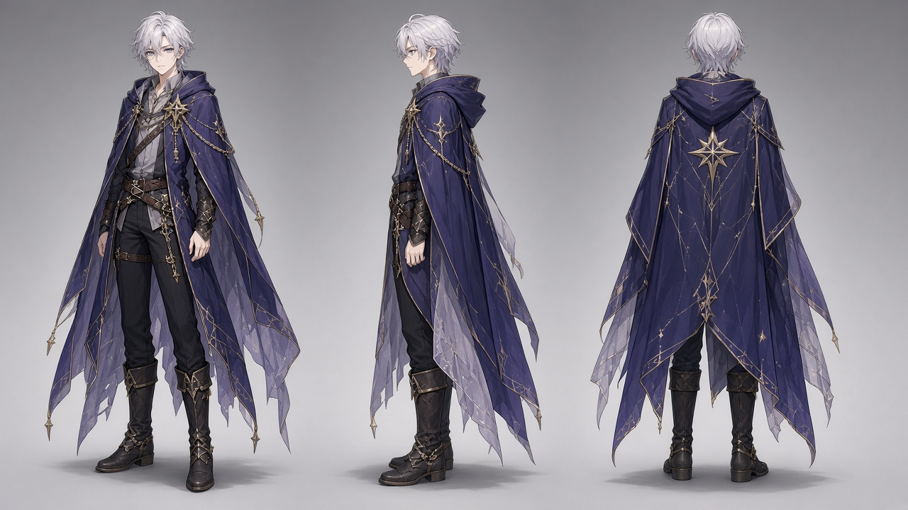

# Prism

**用对话做品牌内容生产。**  
查规范 → 出图出片 → 改一版 → 归档资产；同一套多租户控制台里完成，后续可接到社媒发布与付费投放。

[](https://github.com/jintao0693/Prism/actions/workflows/ci.yml)
[](LICENSE)

| | |
|---|---|
| **开发者** | [jintao](https://github.com/jintao0693) |
| **状态** | MVP 可用（创作对话 / 知识库 / 资产 / 火山方舟） |
| **产品说明** | [docs/PRODUCT.md](docs/PRODUCT.md) |
| **许可** | MIT |

---

## 解决什么问题

营销与内容团队缺的不是「再一个出图按钮」，而是**可审计的创意生产线**：规范要管事、改稿要不断血、同角色跨镜头不能崩、静帧还能接着出预告。Prism 把这条链路收成一次对话：

1. **规范进知识库** — 主色、禁忌、历史 KV 变成对话里的活约束  
2. **人话驱动多模态** — 出图、改稿、拉预告都在同一会话  
3. **血缘可追溯** — 每一轮记住上一张，`parentAssetId` 挂成资产树  
4. **结果进资产库** — 评审、复用、后续发布 / 投放有同一套归档

适合：游戏发行内容组、品牌 / 电商运营、投放创意、内容主理人。

---

## 现在能做什么

| 你想做的事 | Prism 怎么帮你 |
|------------|----------------|
| 问品牌主色、立绘禁忌、活动话术 | 勾选知识库，对话里直接答，可引用入库文档 |
| 从零出一张主视觉 / 封面 / KV | 自然语言生图，结果进资产中心 |
| 在上一张基础上改色、改氛围、保留构图 | 自动走图生图，并记下父子素材关系 |
| 把定稿静帧做成短预告 | 图生视频，带任务进度 |
| 多张分镜 / 定妆参考拉长预告 | Seedance 2.x **多模态参考生视频**（多图 `reference_image`，最长约 15s） |
| 多团队共用、密钥隔离 | 租户 / 工作空间隔离；火山 Key 租户自配 |

**下一阶段**：视频片段检索、社媒矩阵发布、巨量 / Meta 投放草稿 — 见 [ROADMAP.md](ROADMAP.md)。

---

## 产品案例：先看 15 秒，再看工作流

随便出一张二次元图不难。难的是：**多张分镜锁住同一角色 → 一口气拉出 15 秒发行预告 → 改稿与规范还能追溯**。  
虚构手游 **《幻境：星落传说》**；完整记录见 [docs/GAME_CASES.md](docs/GAME_CASES.md)。

---

### 明星案例 · 多模态参考 → 15 秒发行预告

**难在哪**  
5 秒氛围片只能「推一下镜头」。发行周要的是能投商店 / 社媒的 **15 秒叙事预告**：开场立人设、中段给世界与动作、收束给希望感——而且主角脸和披风不能崩成三个人。

**怎么做（多模态参考）**

1. 先连出多张分镜静帧（悬崖开场 / 星轨桥 / 肖像锁脸 / 遗迹 / 跃迁 / 终章提灯）  
2. 把这些图作为 **多模态参考**（角色 + 场景 + 情绪，而不是只塞一张首帧）  
3. 生成 **约 15 秒** 预告：缓推 + 环绕，深空靛 / 星辉金气质贯穿

**分镜参考板**

| 开场 | 星轨桥 | 锁脸 | 遗迹 | 跃迁 | 终章 |
|---|---|---|---|---|---|
|  |  |  |  |  |  |

**成片（页面内直接播放）**

<p align="center">
  <video width="720" controls muted playsinline preload="metadata">
    <source src="https://cdn.jsdelivr.net/gh/jintao0693/Prism@main/docs/media/cases/case-adv-15s.mp4" type="video/mp4" />
  </video>
</p>

仓库内备份：[`docs/media/cases/case-adv-15s.mp4`](docs/media/cases/case-adv-15s.mp4)。产品侧已支持 Seedance 2.x 多模态参考生视频（多图 `reference_image`，最长约 15s）；设置页换成已开通的 Seedance 2.x Model ID 即可调用。
**别人看完会想用的点**  
不是「再出一张静帧」，而是 **分镜资产 → 多模态参考 → 可投放时长的成片**，这才是发行内容组愿意换工具的理由。

---

### 高级案例 · 母版血缘树（可审计，不是散装 JPG）

同一会话：文生图母版 →「再偏暖」图生图 → 图生视频；每步带 `parentAssetId`。规范（深空靛 / 禁霓虹紫）是对话里的活约束。


| 联调母版 | 偏暖子稿 | 规范纠偏（左违规 / 右合规） |
|---|---|---|
|  |  |  |

早期 5 秒联调片：[case3-teaser.mp4](docs/media/cases/case3-teaser.mp4)

---

### 高级案例 · 定妆锁角色 → 三镜叙事板

先锁定妆，再铺探索 / 战斗 / 城镇夜——避免外包把主角做成三个人；再挑一镜进预告链路。



| 探索 | 战斗 | 城镇夜 |
|---|---|---|
|  |  |  |

---

### 整条生产线

```text
知识库锁规范 + 定妆 / 分镜多图
        → 母版 KV → 可追溯改稿（parentAssetId）
        → 多模态参考 → 约 15 秒发行预告
        → 全部进入资产中心，供评审与复用
```

---

## 5 分钟体验

演示账号：`linqing@prism.demo` / `prism123`（工作空间示例 `ws_spring`）

```bash
# 准备依赖
.\scripts\dev.ps1          # Windows
# ./scripts/dev.sh         # macOS / Linux

# 终端 1 · API
cd apps/api && .\.venv\Scripts\activate
uvicorn app.main:app --reload --host 127.0.0.1 --port 8000

# 终端 2 · 控制台
cd apps/web && npm run dev
```

打开 http://localhost:3000 → 登录 → 选工作空间 → **设置**里填写火山方舟 Key（可选；无 Key 也可走演示模式看流程）。

复现基础闭环（案例 1–3）：

```bash
# 需本机 API 已启动；配好火山 Key 可跑真图真视频
python scripts/run_game_cases.py
```

更细的安装、Docker、模型配置见 [apps/api/README.md](apps/api/README.md)、[apps/web/README.md](apps/web/README.md)。

---

## 文档

| 想了解 | 去看 |
|--------|------|
| 产品定位、用户、MVP / Phase 范围 | [docs/PRODUCT.md](docs/PRODUCT.md) |
| 当前做到哪了 | [docs/PROGRESS.md](docs/PROGRESS.md) |
| 产品与技术优化 backlog | [docs/OPTIMIZATION.md](docs/OPTIMIZATION.md) |
| 游戏向案例联调详情 | [docs/GAME_CASES.md](docs/GAME_CASES.md) |
| 路线图 | [ROADMAP.md](ROADMAP.md) |
| 架构与目录 | [docs/TECHNICAL.md](docs/TECHNICAL.md)、[docs/STRUCTURE.md](docs/STRUCTURE.md) |
| 如何贡献 | [CONTRIBUTING.md](CONTRIBUTING.md) |

---

## 开发者与贡献

本项目由 **jintao**（[@jintao0693](https://github.com/jintao0693)）设计与维护。欢迎 Issue / PR，请先阅读 [CONTRIBUTING.md](CONTRIBUTING.md)。

```bash
cd apps/api && pip install -e ".[dev]" && ruff check app && pytest -q
cd apps/web && npm run lint && npm run build
```

## License

[MIT](LICENSE) © jintao
