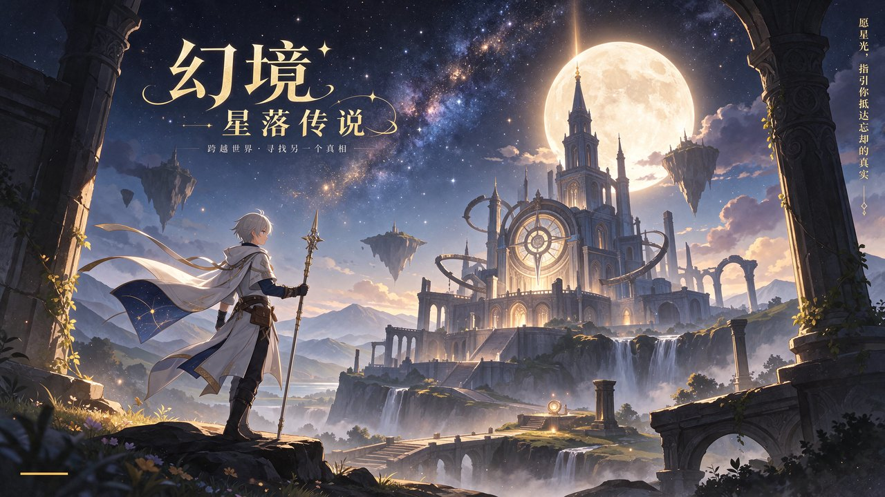

# Prism

**用对话做品牌内容生产。**  
查规范 → 出图出片 → 改一版 → 归档资产；同一套多租户控制台里完成，后续可接到社媒发布与付费投放。

[](https://github.com/jintao0693/Prism/actions/workflows/ci.yml)
[](LICENSE)

| | |
|---|---|
| **开发者** | [jintao](https://github.com/jintao0693) |
| **状态** | MVP 可用（创作对话 / 知识库 / 资产 / 火山方舟） |
| **产品说明** | [docs/PRODUCT.md](docs/PRODUCT.md) |
| **许可** | MIT |

---

## 解决什么问题

营销与内容团队日常要在「品牌规范、历史素材、生图工具、剪辑、网盘」之间来回跳。Prism 把这条链路收成一次对话：

1. **先对齐品牌** — 把设定、主色、禁忌词、历史 KV 放进知识库，提问时直接引用  
2. **再说人话出片** — 「做一张商店页头图」「再偏暖一点」「做成 5 秒预告」  
3. **改稿不断血** — 每一轮生成记住上一张图，图生图 / 图生视频可追溯  
4. **素材进资产库** — 结果自动归档，方便后续复用（发布与投放在路线图里）

适合：品牌 / 电商运营、游戏发行内容组、投放创意、内容主理人。

---

## 现在能做什么

| 你想做的事 | Prism 怎么帮你 |
|------------|----------------|
| 问品牌主色、立绘禁忌、活动话术 | 勾选知识库，对话里直接答，可引用入库文档 |
| 从零出一张主视觉 / 封面 / KV | 自然语言生图，结果进资产中心 |
| 在上一张基础上改色、改氛围、保留构图 | 自动走图生图，并记下父子素材关系 |
| 把定稿静帧做成短预告 | 图生视频，带任务进度 |
| 多团队共用、密钥隔离 | 租户 / 工作空间隔离；火山 Key 租户自配 |

**下一阶段**：视频片段检索、社媒矩阵发布、巨量 / Meta 投放草稿 — 见 [ROADMAP.md](ROADMAP.md)。

---

## 产品案例：一款二次元开放世界的发行周

以下三个案例串起同一款虚构手游 **《幻境：星落传说》** 的上线前内容工作：先把视觉规范沉淀进知识库，再产出商店页主视觉并多轮改稿，最后用定稿静帧拉一条预告短视频。  
素材来自本机联调真实出图 / 出片（火山方舟）；完整记录见 [docs/GAME_CASES.md](docs/GAME_CASES.md)。

### 案例 1 · 发行周：把「能拍的规范」问清楚

**场景**  
发行内容组周一开会：商店页、社媒 KV、预告片都要开做，但美术规范散落在几份文档里。主美不在场，运营又怕主色、禁忌词说错，返工成本很高。

**在 Prism 里怎么做**

1. 新建知识库「幻境：星落传说 · 设定库」  
2. 入库品牌视觉说明（主色深空靛 / 星辉金、立绘禁忌、开放世界主题词）  
3. 开创作对话，勾选该知识库，连续追问：主色与点缀色是什么？立绘有什么不能碰？商店页头图更适合什么氛围？


**产品价值**  
不是「搜一下文档」，而是把规范变成对话里的即时约束：后续出图、改稿、做预告时，团队对「什么叫对」有同一套答案。

---

### 案例 2 · 商店页主视觉：从一句话到可改稿的 KV

**场景**  
商店页头图要在周四前提交。需求是：横版、深空靛底、星辉金点缀、旅人站在月下遗迹前、干净留白、适合应用商店头图。初稿出来后发行觉得「偏冷、不够召回」，要求**构图和人物位置不动**，整体再偏暖一点。

**在 Prism 里怎么做**

1. 同一会话里先下达完整商店页 brief，生成第一版主视觉  
2. 直接说：「再偏暖一点，保留构图与人物位置」  
3. 在资产中心打开两版，确认第二版挂在第一版的改稿血缘上

| 文生图初稿 | 「再偏暖」图生图改稿 |
|---|---|
|  |  |

**产品价值**  
创意迭代留在对话里，不必导出到外部修图工具再传回；「上一张」被记住，改稿指令可以很短；父子关系可追溯，方便评审「改了什么」。

---

### 案例 3 · 预告氛围片：定稿静帧一键拉成 5 秒片

**场景**  
商店页 KV 已定。发行还要一条 **5 秒氛围预告** 给商店详情与社媒首发：镜头缓慢推进、星尘飘落，气质跟主视觉一致，不能另起炉灶重新分镜。

**在 Prism 里怎么做**

1. 仍在同一创作会话（承接案例 2 的最近一张图）  
2. 说：「把上一张主视觉做成 5 秒预告氛围短视频：镜头缓慢推进，星尘飘落」  
3. 等待视频任务进度完成，成片进入资产中心，与静帧素材放在一起管理



[下载 / 播放 5 秒预告成片（MP4）](docs/media/cases/case3-teaser.mp4)

> GitHub README 对内嵌 `<video>` 支持有限，成片以仓库内 MP4 为准；克隆或点开上述链接即可预览。

**产品价值**  
跨模态接力：静帧 → 动态预告，不必再开一条互不相关的视频流水线；参考图来自对话上下文里的定稿，品牌连续性更好。

---

### 三条案例串起来看

```text
规范入库 → 对话对齐 brief
        → 商店页 KV 文生图
        → 「再偏暖」图生图改稿（可追溯）
        → 定稿静帧 → 5 秒氛围预告
        → 全部进入资产中心
```

这就是 Prism MVP 想证明的闭环：**知识约束创作，对话驱动改稿，多模态结果统一归档**。

---

## 5 分钟体验

演示账号：`linqing@prism.demo` / `prism123`（工作空间示例 `ws_spring`）

```bash
# 准备依赖
.\scripts\dev.ps1          # Windows
# ./scripts/dev.sh         # macOS / Linux

# 终端 1 · API
cd apps/api && .\.venv\Scripts\activate
uvicorn app.main:app --reload --host 127.0.0.1 --port 8000

# 终端 2 · 控制台
cd apps/web && npm run dev
```

打开 http://localhost:3000 → 登录 → 选工作空间 → **设置**里填写火山方舟 Key（可选；无 Key 也可走演示模式看流程）。

复现上文三个案例：

```bash
# 需本机 API 已启动；配好火山 Key 可跑真图真视频
python scripts/run_game_cases.py
```

更细的安装、Docker、模型配置见 [apps/api/README.md](apps/api/README.md)、[apps/web/README.md](apps/web/README.md)。

---

## 文档

| 想了解 | 去看 |
|--------|------|
| 产品定位、用户、MVP / Phase 范围 | [docs/PRODUCT.md](docs/PRODUCT.md) |
| 当前做到哪了 | [docs/PROGRESS.md](docs/PROGRESS.md) |
| 游戏向案例联调详情 | [docs/GAME_CASES.md](docs/GAME_CASES.md) |
| 路线图 | [ROADMAP.md](ROADMAP.md) |
| 架构与目录 | [docs/TECHNICAL.md](docs/TECHNICAL.md)、[docs/STRUCTURE.md](docs/STRUCTURE.md) |
| 如何贡献 | [CONTRIBUTING.md](CONTRIBUTING.md) |

---

## 开发者与贡献

本项目由 **jintao**（[@jintao0693](https://github.com/jintao0693)）设计与维护。欢迎 Issue / PR，请先阅读 [CONTRIBUTING.md](CONTRIBUTING.md)。

```bash
cd apps/api && pip install -e ".[dev]" && ruff check app && pytest -q
cd apps/web && npm run lint && npm run build
```

## License

[MIT](LICENSE) © jintao
