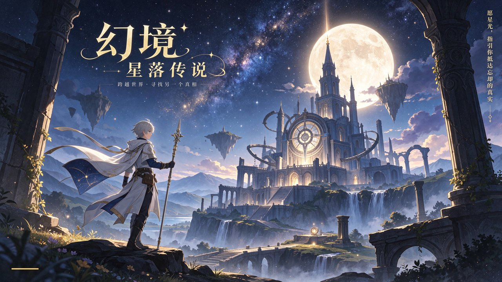
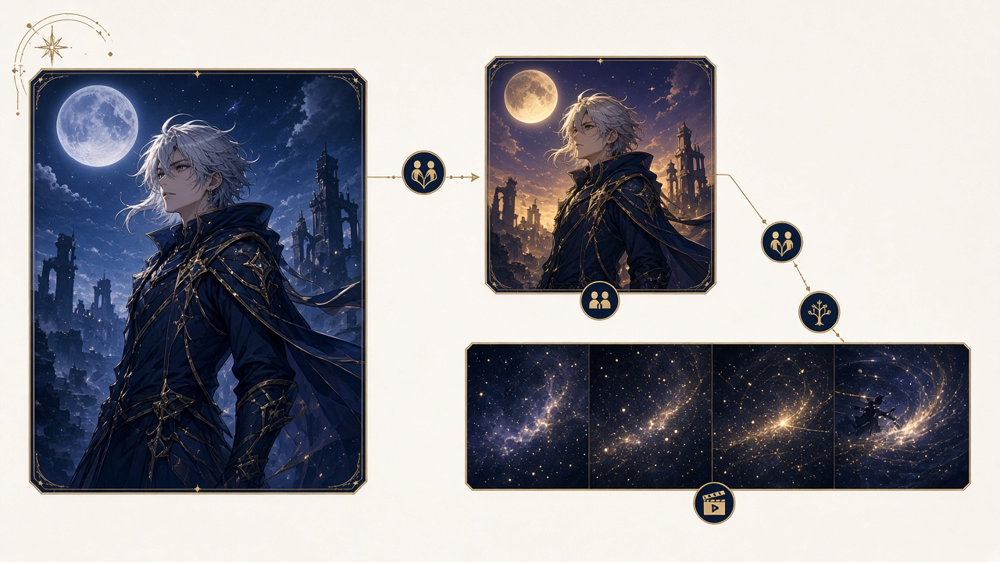

# 游戏向产品案例：《幻境：星落传说》发行周

> 最近联调：2026-11-16 · 账号 `linqing@prism.demo` · 工作空间 `ws_spring`  
> 复现：`python scripts/run_game_cases.py`  
> 产品叙事摘要已写入根 [README.md](../README.md)

叙事分三层：**案例 1–3** 联调真出；**高级 A–B** 母版血缘 / 定妆多镜；**明星案例** 多模态参考 → 约 15 秒发行预告。素材在 [`docs/media/cases/`](media/cases/)，对外摘要在根 [README.md](../README.md)。

| 文件 | 说明 |
|------|------|
| `case1-brand-brief.jpg` | 知识库 brief / 主色示意 |
| `case2-kv-v1.jpg` | 商店页 KV 文生图初稿 |
| `case2-kv-warm.jpg` | 「再偏暖」图生图改稿 |
| `case3-teaser-poster.jpg` | 预告关键静帧 |
| `case3-teaser.mp4` | 5 秒图生视频成片 |
| `sb-01-cliff.jpg` … `sb-06-leap.jpg` | 15s 预告分镜参考板 |
| `case-adv-15s.mp4` | 约 15 秒多模态参考成片（README 内嵌可播） |
| `case-adv-lineage-board.jpg` | 母版血缘板示意 |
| `case-adv-kb-guardrail.jpg` | 规范纠偏（违规 vs 合规） |
| `case-adv-char-lock.jpg` | 定妆三视图 |
| `case-adv-scene-explore.jpg` | 叙事镜 · 探索 |
| `case-adv-scene-battle.jpg` | 叙事镜 · 战斗 |
| `case-adv-scene-city.jpg` | 叙事镜 · 城镇夜 |

---

## 案例 1 · 发行周：把「能拍的规范」问清楚

### 业务背景

商店页、社媒 KV、预告片同一周开工。视觉规范（主色、点缀色、立绘禁忌、主题词）必须先对齐，否则后面三组素材会各说各话。

### 用户动作

1. 创建知识库「幻境：星落传说 · 设定库」  
2. 入库文档《主视觉与主色》（深空靛 `#1B1F3B`、星辉金 `#F0C75E`、禁用高饱和霓虹紫、月下遗迹 / 旅人共鸣等主题）  
3. 创作对话勾选该库，追问主色、点缀与立绘禁忌，把回答当本周 brief

### 产品验收

| 项 | 结果 |
|----|------|
| 知识库创建 + 文档入库（含向量） | ✅ |
| 勾选 KB 后走检索增强问答 | ✅ `knowledge` → `kb_search_text` |
| 回答命中主色与立绘禁忌 | ✅ |

联调样例：知识库 `kb_f5fe90b977` · 会话 `c_1af86d1c0c`


---

## 案例 2 · 商店页主视觉：从一句话到可改稿的 KV

### 业务背景

商店页头图：横版、深空靛底、星辉金点缀、旅人站在月下遗迹前、干净留白。初稿偏冷，发行要求**构图与人物不动**，整体再偏暖，便于召回。

### 用户动作

1. 同一会话下达完整商店页 brief → 文生图  
2. 「再偏暖一点，保留构图与人物位置」→ 图生图  
3. 资产中心对照两版，确认改稿血缘

### 产品验收

| 项 | 结果 |
|----|------|
| 首轮文生图 | ✅ `text_to_image` |
| 「再偏暖」图生图 | ✅ `image_to_image` |
| 改稿带 `parentAssetId` | ✅ |
| 两版可预览归档 | ✅ |

联调样例：会话 `c_389a95e37f`  
- A：`.../6b76939ec10c4640b645e9d484f55eaa_volc_image.png`  
- B：`.../bf1d62dd0e5a40c2bf6f1b8da8fca57b_volc_image_edit.png`（parent `asset_648d30c3b0f4`）

| 初稿 | 偏暖改稿 |
|------|----------|
|  |  |

---

## 案例 3 · 预告氛围片：定稿静帧拉成 5 秒片

### 业务背景

KV 已定。还要 5 秒氛围预告给商店详情与社媒首发：缓慢推进 + 星尘飘落，气质跟主视觉一致，不另起分镜。

### 用户动作

1. 仍在案例 2 同一会话  
2. 「把上一张主视觉做成 5 秒预告氛围短视频：镜头缓慢推进，星尘飘落」  
3. 等视频进度完成，成片与静帧一并进资产中心

### 产品验收

| 项 | 结果 |
|----|------|
| 识别为图生视频 | ✅ `image_to_video` |
| 引用上一张图（parent） | ✅ |
| 成片可播放并归档 | ✅ |

联调样例：`.../6c1e44df14e64983a94c0284b047f41e_volc_i2v.mp4`（parent `asset_63acd73d2aea`）  
说明：方舟首帧图生视频不传 `ratio`（比例跟随首帧图）。


[下载 / 播放成片 MP4](media/cases/case3-teaser.mp4)

---

## 明星案例 · 多模态参考 → 约 15 秒发行预告

### 业务背景

发行周需要可投商店 / 社媒的 15 秒叙事预告：开场立人设、中段给世界与动作、收束给希望感；主角外形必须跨镜一致。

### 用户动作

1. 连出多张分镜静帧（开场 / 桥 / 肖像 / 遗迹 / 跃迁 / 终章）  
2. 作为多模态 `reference_image` 输入（Seedance 2.x；与首帧模式互斥）  
3. `duration=15` 拉成片，进资产中心

https://github.com/user-attachments/assets/0bb9d578-d415-4eaa-8513-d5e5e5d0ce17


API：`VolcengineMediaProvider.reference_to_video` / `VolcengineArkClient.create_video_task(..., reference_image_urls=...)`。

---

## 高级 A · 母版血缘树（工作流，不是单张图）

### 业务背景

评审要追问：初稿是谁、偏暖版挂在谁下面、预告首帧是哪张定稿、有没有撞禁用霓虹紫。需要的是**可审计资产树**，不是互不相关的 JPG。

### 用户动作

1. 勾选知识库约束主色 / 禁忌  
2. 同会话：文生图母版 → 图生图改稿 → 图生视频预告  
3. 资产中心沿 `parentAssetId` 回看整棵树；违规光色可对照规范纠偏



| 母版（联调） | 偏暖子稿（联调） | 规范纠偏示意 |
|--------------|------------------|--------------|
|  |  |  |

---

## 高级 B · 定妆锁角色 → 三镜叙事板 → 选镜拉预告

### 业务背景

同一周要交探索 / 战斗 / 城镇夜三镜 + 预告。先锁定妆，再铺镜头，再动起来——避免外包把主角做成三个人。

### 用户动作

1. 定妆三视图挂进会话作参考  
2. 连续三镜 brief，锁「银发旅人 / 靛色披风 / 星辉金扣」  
3. 选探索镜做图生视频


| 探索 | 战斗 | 城镇夜 |
|------|------|--------|
|  |  |  |

---

## 闭环一览

| 案例 | 业务问题 | 产品能力 | 状态 |
|------|----------|----------|------|
| 1 | 规范散、怕说错 | 知识库约束对话 brief | ✅ 联调 |
| 2 | 商店页要快迭代 | 文生图 → 图生图血缘改稿 | ✅ 联调 |
| 3 | 静帧要变成预告 | 图生视频跨模态接力 | ✅ 联调 |
| 高级 A | 改稿要可审计 | 母版树 + 规范活约束 | ✅ 示意（挂联调真出） |
| 高级 B | IP 跨镜不崩 | 定妆锁 → 多镜 → 预告 | ✅ 示意 |

```text
知识库锁规范 + 定妆锁角色
        → 母版 KV → 可追溯改稿
        → 三镜叙事板（同 IP）
        → 选镜拉预告
        → 资产中心归档供评审
```

---

## 仍可继续优化（产品侧）

1. 资产中心可视化血缘树（不只列表 parent）  
2. 从知识库自动编译品牌色、禁忌词进提示词  
3. 定妆参考强制注入多轮图生图  
4. 长视频改异步任务，对话只订进度  
5. 多步原生 tool calling（一次说清：三镜 + 预告）  
